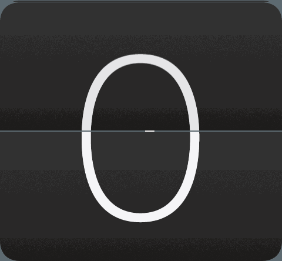
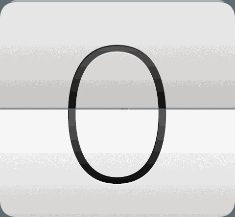

# RetroSense ⏱️☁️

[](https://developer.android.com/)
[](https://github.com/sokkaUmB/RetroSense)
[](https://open-meteo.com/)
[](https://github.com/sokkaUmB/RetroSense)
[](LICENSE.md)
[](https://revolut.me/sokkapkd)

> **A passionate tribute to the legendary HTC Sense Flip Clock & Weather widget — fully modernized and engineered for contemporary Android devices.**

---

### Language / Lingua
- [🇬🇧 English](#-english)
- [🇮🇹 Italiano](#-italiano)

---

# 🇬🇧 English

## An Homage to HTC Sense
During the golden age of Android, no software interface left a more lasting impression than **HTC Sense**. Debuting on iconic devices like the **HTC Hero, Desire, HD2, and One (M7/M8)**, the **HTC Sense 4x2 Flip Clock & Weather** widget became the defining visual signature of premium mobile design.

Over the years, the original widget was lost to time: HTC shut down its weather servers, the legacy 3D framework became incompatible with modern Android runtimes, and aggressive OS battery optimizations broke background updates.

**RetroSense is a dedicated tribute and open-source revitalization of that legendary widget.** Engineered from the ground up for **Android 10 through Android 15+** (tested on Nothing OS, Google Pixel UI, and Samsung One UI), RetroSense preserves the timeless elegance and mechanical delight of the original HTC visual design while delivering modern independence, speed, and efficiency.

---

## 📸 Previews

| Dark Mode Flip | Light Mode Flip |
| :---: | :---: |
|  |  |

---

## ✨ Key Features

- **🕒 Authentic 50 FPS Mechanical Split-Flap Animation:**
  - Silky-smooth frame-by-frame 3D flap physics.
  - Realistic flap folding ($0^\circ \to 90^\circ$) and unfolding ($90^\circ \to 180^\circ$) with depth lighting and shadows.
  - Seamless zero-gap resting transition: perfectly aligned with no jumping pixels or black separator bars.

- **⚡ Classic Catch-Up Roll on Screen Wakeup:**
  - Faithful to the original experience: unlocking your device after inactivity triggers a rapid mechanical ratcheting roll through elapsed minutes directly to current time.

- **🌓 Dual Themes: AMOLED Dark & Classic Light:**
  - **Classic Light:** Original pristine white plates, dark numerals, and classic styling.
  - **AMOLED Dark:** Sleek graphite-black plates, crisp high-contrast white digits, and subtle border accents optimized for modern OLED screens.

- **☁️ Independent Open-Meteo Weather Backend:**
  - Zero API keys or user registrations required.
  - Automatic geolocation with intelligent offline caching.
  - Real-time temperature (°C / °F), high/low forecasts, and localized condition descriptions.

- **🔋 Zero Idle Battery Drain (True Deep Sleep):**
  - **0 background wakelocks** and **0 screen-off alarms**.
  - While your screen is off, your CPU stays 100% in Doze mode. Synchronizes instantly upon screen unlock.

- **🌐 Native Bilingual Support:**
  - Automatic detection of system locale: **English** and **Italian**.
  - Localized dates (e.g. `Friday, October 30` vs `Venerdì, 30 ottobre`) and translated weather descriptions.

- **🎨 Modern AMOLED Widget Setup Screen:**
  - Fast widget configuration activity with dark theme preview, city search, and real-time settings.

---

## 🚀 Installation

1. Download the latest pre-built APK: [`RetroSense.apk`](RetroSense.apk) (or from [Releases](https://github.com/sokkaUmB/RetroSense/releases)).
2. Install the APK on your device (allow *"Install unknown apps"* if prompted).
3. Long-press an empty space on your home screen and select **Widgets**.
4. Choose **RetroSense 4x2** and place it on your screen.
5. Select your location and theme in the setup screen and tap **Done**.

---

## 🛠️ Building from Source

The repository contains only the clean sources and build automation scripts required to reproduce the APK:

### Prerequisites
- Java JDK 8 or newer (`javac`)
- Python 3.8+
- Android SDK Platform Tools (`d8`, `zipalign`, `apksigner`)
- [Apktool](https://apktool.org/)

### Build Commands
```bash
# 1. Compile RetroSenseBridge Java engine and inject into package
python compile_retrosense.py

# 2. Reassemble with Apktool, align to 4-byte boundaries, and sign
python build_retrosense.py

# The signed APK is generated at ./RetroSense.apk
```

---

## 🏛️ Architecture Overview

- **`retrosense_app/`**: Core Android application source tree containing layouts, localized strings, graphic drawables, and package structures.
- **`RetroSenseBridge.java`**: Custom Java 2D rendering and state engine bridging Android `RemoteViews` with dynamic 50 fps bitmap frame sequencing and asynchronous Open-Meteo REST calls.
- **`compile_retrosense.py`**: Compiles Java bytecode, strips Java 21+ attributes for D8 DEX compatibility, disassembles DEX, and injects classes into the app package.
- **`build_retrosense.py`**: Automated packaging pipeline executing Apktool assembly, 4-byte zipalign, and cryptographic signing with `apksigner`.

---

## ☕ Support the Project

If you enjoy **RetroSense** and would like to support the ongoing development, animation physics tuning, and preservation of iconic mobile interfaces, you can buy me a coffee via Revolut:

👉 **[Support via Revolut (revolut.me/sokkapkd)](https://revolut.me/sokkapkd)**

*(Supports Apple Pay, Google Pay, Revolut, and all major debit/credit cards worldwide).*

---

## 📄 License

This project is licensed under the **Creative Commons Attribution-NonCommercial 4.0 International Public License** ([`CC BY-NC 4.0`](LICENSE.md)).

```
You are free to:
- Share — copy and redistribute the material in any medium or format
- Adapt — remix, transform, and build upon the material

Under the following terms:
- Attribution — You must give appropriate credit to sokkaUmB.
- NonCommercial — You may not use the material for commercial purposes.
```

---

## 📜 Disclaimer & Credits

- **HTC Sense** and the original clock/weather design are trademarks and intellectual property of **HTC Corporation**.
- This project is an independent, non-profit open-source initiative created for tribute, historical preservation, and technical study: while the visual artwork and aesthetic styling are inspired by HTC's iconic design, **the entire operational logic, 50 FPS split-flap rendering engine, and widget management are the result of autonomous software programming**, developed to emulate the exact physical mechanics and behavior of the original widget as faithfully as possible on modern Android devices.
- Weather data provided freely by [Open-Meteo](https://open-meteo.com/).

---

# 🇮🇹 Italiano

## Un Omaggio a HTC Sense
Durante l'epoca d'oro di Android, nessuna interfaccia utente ha lasciato un segno più profondo di **HTC Sense**. Introdotto su smartphone memorabili come **HTC Hero, Desire, HD2 e la serie One (M7/M8)**, l'orologio a foglietto con meteo **HTC Sense 4x2** è diventato il simbolo universale del design mobile di qualità.

Nel corso degli anni, il widget originale era diventato inutilizzabile: la dismissione dei server meteo HTC, l'incompatibilità del vecchio framework 3D con le nuove versioni di Android e le moderne restrizioni sul consumo energetico ne avevano decretato la fine.

**RetroSense nasce come omaggio appassionato e opera di rivitalizzazione open-source di questo straordinario widget.** Ricostruito da zero per funzionare su **Android 10 fino ad Android 15+** (testato su Nothing OS, Google Pixel UI e Samsung One UI), RetroSense unisce l'estetica inconfondibile del disegno originale a un'architettura moderna, autonoma, fluida e ad altissima efficienza.

---

## 📸 Previews

| Dark Mode Flip | Light Mode Flip |
| :---: | :---: |
|  |  |

---

## ✨ Caratteristiche Principali

- **🕒 Animazione Meccanica a Foglietto a 50 FPS:**
  - Fisica 3D della paletta fluida fotogramma per fotogramma.
  - Chiusura a 90° e apertura a 180° realistiche con luci e ombre prospettiche.
  - Transizione atomica allo stato di riposo con **zero pixel di discrepanza** visiva: nessun salto di fotogramma né barre anomale.

- **⚡ Rullata Catch-Up al Risveglio dello Schermo:**
  - Fedele all'esperienza originale: riattivando il telefono dopo un periodo di standby, l'orologio esegue una rapida rullata meccanica dei minuti trascorsi fino all'ora esatta.

- **🌓 Doppio Tema: Dark AMOLED e Light Classico:**
  - **Light Classico:** Iconiche palette bianche, numeri scuri e dettagli stilistici classici.
  - **Dark AMOLED:** Palette nero grafite, numeri bianchi ad alto contrasto e bordi scuri, ideali per display OLED a basso consumo.

- **☁️ Meteo Autonomo con Open-Meteo:**
  - Nessuna registrazione o chiave API richiesta.
  - Geolocalizzazione automatica e cache locale affidabile.
  - Temperature minime/massime, temperatura istantanea (°C / °F) e condizioni meteo in italiano.

- **🔋 Zero Consumo a Schermo Spento (Deep Sleep):**
  - **0 wakelock persistenti** e **0 allarmi a schermo spento**.
  - A schermo spento la CPU rimane al 100% in modalità Doze. L'orario si sincronizza istantaneamente alla riaccensione dello display.

- **🌐 Supporto Bilingue Nativo:**
  - Riconoscimento automatico della lingua di sistema: **Italiano** e **Inglese**.
  - Date localizzate (`Venerdì, 30 ottobre`) e condizioni meteo tradotte.

- **🎨 Schermata di Configurazione Moderna AMOLED:**
  - Selezione intuitiva del widget con anteprima scura, ricerca rapida della città e applicazione immediata del tema.

---

## 🚀 Installazione

1. Scarica il file APK aggiornato: [`RetroSense.apk`](RetroSense.apk) (oppure dalla sezione [Releases](https://github.com/sokkaUmB/RetroSense/releases)).
2. Installa l'APK sul dispositivo (consenti l'installazione da app sconosciute se richiesto).
3. Tieni premuto uno spazio vuoto sulla schermata home e tocca **Widget**.
4. Seleziona **RetroSense 4x2** e posizionalo sulla home.
5. Nella schermata di configurazione scegli città e tema preferito, quindi tocca **Salva ed Applica**.

---

## 🛠️ Compilazione dai Sorgenti

Il repository contiene esclusivamente i sorgenti e gli script necessari per generare l'APK da zero:

### Prerequisiti
- Java JDK 8 o successivo (`javac`)
- Python 3.8+
- Android SDK Platform Tools (`d8`, `zipalign`, `apksigner`)
- [Apktool](https://apktool.org/)

### Comandi di Build
```bash
# 1. Compila il motore grafico Java RetroSenseBridge e inietta nel pacchetto
python compile_retrosense.py

# 2. Assembla con Apktool, allinea a 4-byte e firma l'APK
python build_retrosense.py

# L'APK firmato e pronto all'uso sarà generato in ./RetroSense.apk
```

---

## ☕ Sostieni il Progetto

Se apprezzi **RetroSense** e desideri supportare lo sviluppo continuo, l'affinamento della fisica delle animazioni e la preservazione delle storiche interfacce mobile, puoi offrirmi un caffè tramite Revolut:

👉 **[Sostieni via Revolut (revolut.me/sokkapkd)](https://revolut.me/sokkapkd)**

*(Supporta Apple Pay, Google Pay, Revolut e tutte le principali carte di debito/credito internazionali).*

---

## 📄 Licenza d'Uso

Questo progetto è distribuito sotto licenza **Creative Commons Attribution-NonCommercial 4.0 International Public License** ([`CC BY-NC 4.0`](LICENSE.md)).

```
Sei libero di:
- Condividere — copiare e ridistribuire il materiale con qualsiasi mezzo e formato
- Modificare — remixare, trasformare il materiale e basarti su di esso

Ai seguenti termini:
- Attribuzione — Devi riconoscere la paternità dell'opera a sokkaUmB.
- NonCommerciale — Non puoi usare il materiale per fini commerciali o di lucro.
```

---

## 📜 Crediti e Disclaimer Legale

- **HTC Sense** e la grafica originale del widget orologio/meteo sono marchi registrati e proprietà intellettuale di **HTC Corporation**.
- Questo progetto è un'iniziativa open-source e no-profit a scopo di omaggio, preservazione storica e studio tecnico: mentre l'estetica visiva e il disegno prendono ispirazione da quello originale HTC, **l'intera logica di funzionamento, il motore di rendering a 50 FPS e la gestione del widget sono frutto di una programmazione software autonoma**, sviluppata per emulare nel modo più esatto e fedele possibile la fisica e il comportamento del widget storico sui dispositivi Android moderni.
- I dati meteorologici sono forniti gratuitamente dal servizio [Open-Meteo](https://open-meteo.com/).
